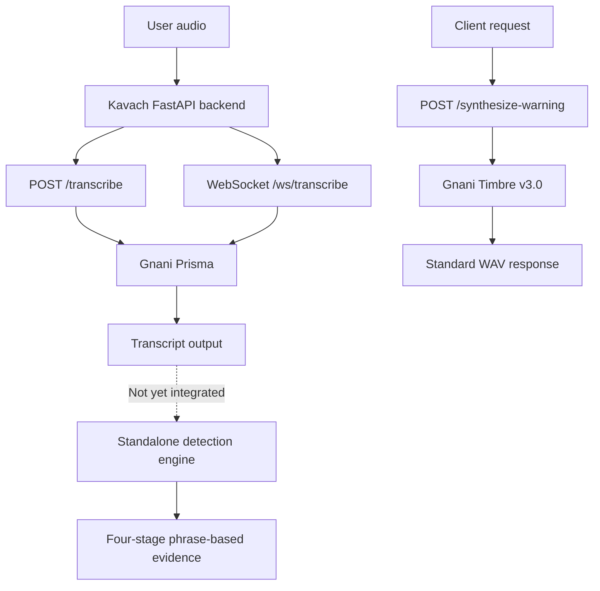

# Kavach - System Architecture

## 1. Project Overview

Kavach is an AI-powered, multilingual voice safety companion designed to detect potential digital-arrest scams during conversations.

It aims to identify four major scam behaviours:
- Impersonation of police, government officials or other authorities.
- Threats, intimidation and fabricated legal consequences.
- Attempts to isolate victims from family members.
- Pressure to transfer money or disclose financial information.

Kavach is an assistance tool, not a guarantee against fraud or a replacement for law enforcement.

## 2. Technology Stack

| Layer | Technology | Purpose |
|---|---|---|
| Backend | Python, FastAPI | API and application services |
| Speech-to-text | Gnani Prisma | REST and streaming audio transcription |
| Text-to-speech | Gnani Timbre v3.0 | Standalone Hindi safety-warning generation |
| Gnani SDK | `gnani-vachana==0.9.0` | Streaming STT and TTS integration |
| HTTP client | HTTPX | Asynchronous REST requests |
| Async execution | Starlette thread pool | Run synchronous TTS SDK calls without blocking the event loop |
| Audio processing | Python standard library | PCM validation and WAV construction |
| Testing | Pytest | Automated verification |
| Frontend | React 19, TypeScript, Vite, Tailwind CSS | Mock-first responsive safety dashboard in `frontend/` |
| Database | Planned | Secure incident metadata storage |

## 3. High-Level Architecture

The current implementation provides two independent transcription paths, a standalone TTS endpoint, and a standalone phrase-based detection engine.



The detection engine can currently be called independently with transcript segments. It is not yet connected to either transcription path. The standalone TTS endpoint is also independent of detection.

Components such as contextual reasoning, risk scoring and automatic warning orchestration remain planned.

## 4. Current Backend Architecture

### 4.1 FastAPI Application

Main application entry point:

`backend/app/main.py`

Responsibilities:
- Initialise the FastAPI application.
- Register the health endpoint.
- Register REST transcription.
- Register standalone safety-warning synthesis.
- Register the WebSocket streaming router.
- Map service errors to appropriate HTTP responses.

### 4.2 Configuration Management

File:

`backend/app/config.py`

Responsibilities:
- Load environment variables.
- Read Gnani API credentials securely from the backend environment.
- Configure the transcription endpoint and language.
- Provide application settings through a cached settings function.

Secrets must remain in `backend/.env`. The file must never be committed to GitHub.

### 4.3 REST Transcription

Endpoint:

`POST /transcribe`

Flow:

1. The client uploads an audio file.
2. FastAPI validates the file extension and size.
3. The backend checks that the Gnani API key is configured.
4. The backend sends the audio to Gnani Prisma using HTTPX.
5. The backend validates the provider response.
6. The transcript and available metadata are returned.

Error handling covers missing configuration, invalid input, oversized files, provider HTTP errors, invalid responses and request timeouts.

Verification:
- One successful live Hindi transcription request through the Kavach backend.
- Automated REST tests use mocked provider responses.

### 4.4 WebSocket Streaming Transcription

File:

`backend/app/streaming.py`

Endpoint:

`/ws/transcribe`

Flow:

1. The browser establishes a WebSocket connection with Kavach.
2. The backend creates a Gnani streaming client.
3. The backend connects to Gnani using server-side credentials.
4. The backend starts a provider-event monitoring task.
5. The browser sends binary PCM audio frames.
6. The backend validates frame sizes and forwards valid frames to Gnani.
7. Gnani connection, processing and transcript events are forwarded to the browser as JSON messages.
8. Provider errors and unexpected provider event-stream termination are handled by notifying the browser and closing the session.
9. Invalid audio-frame errors are delivered before the browser connection is closed.
10. A Stop command causes the backend to send paced silence frames to help detect the end of speech.
11. The backend waits for a transcript event received after the Stop command, subject to a timeout.
12. The backend closes the provider connection and cleans up background tasks.

The backend uses a single outgoing WebSocket writer task to avoid concurrent server-to-client writes. Important outgoing messages can be acknowledged before the session is closed.

The Stop response does not guarantee provider finalisation of the last utterance.

Current audio format:

| Parameter | Value |
|---|---|
| Sample rate | 16,000 Hz |
| Channels | 1 (mono) |
| Encoding | Signed 16-bit little-endian PCM |
| Frame size | 1,024 bytes |
| Frame duration | 32 milliseconds |

Calculation:

- 16,000 samples/second x 2 bytes/sample = 32,000 bytes/second.
- 1,024 bytes / 32,000 bytes/second = 0.032 seconds per frame.
- 32 silence frames x 0.032 seconds = 1.024 seconds.

Verification:
- WebSocket implementation: completed.
- Mocked WebSocket tests: 10 passed.
- Live streaming: verified with one Hindi recording on 2026-11-08.
- Actual provider events included `ready`, `processing`, `transcript` and `stopped`.
- The observed transcript contained recognition errors. This verifies connectivity and event delivery, not general recognition accuracy.
- The latest provider-reported segment latency was 194 ms in one run. This is not an end-to-end latency benchmark.

### 4.5 Standalone Gnani Timbre Text-to-Speech

Service file:

`backend/app/tts.py`

Endpoint:

`POST /synthesize-warning`

Purpose:

Generate Kavach's fixed Hindi safety warning as a WAV audio response. This endpoint currently operates independently of the detection workflow.

Synthesis configuration:

| Parameter | Value |
|---|---|
| Provider | Gnani Timbre |
| Model | `timbre-v3.0` |
| Voice | `Tarika` |
| Language | `hi-IN` |
| Speed | 0.85 |
| Sample rate | 16,000 Hz |
| Channels | Mono |
| Sample format | 16-bit linear PCM |
| Output container | WAV |
| Silence between segments | 350 milliseconds |

Warning segments:

1. `Apna one-time password.`
2. `Kisi ke saath share na karein.`

Processing flow:

1. FastAPI checks that the Gnani API key is configured.
2. The endpoint invokes `synthesize_warning()` through `run_in_threadpool`.
3. The TTS service creates a Gnani TTS client.
4. The synchronous SDK synthesizes the two warning segments separately.
5. The service validates the returned WAV audio format and extracts PCM data.
6. The service inserts 350 milliseconds of silence between the segments.
7. The PCM data is assembled into a standard WAV file.
8. FastAPI returns the audio with content type `audio/wav` and `Cache-Control: no-store`.

The thread-pool execution prevents the synchronous SDK request from directly blocking the asynchronous FastAPI event loop.

Error handling covers missing API configuration, malformed provider audio and synthesis failures. Provider-specific exception details are not exposed to the client.

Verification:
- Five TTS service tests passed.
- Three TTS endpoint tests passed.
- Live endpoint returned HTTP 200 with content type `audio/wav`.
- Live WAV contained 64,330 frames at 16 kHz.
- Duration calculation: 64,330 / 16,000 = 4.020625 seconds.
- The user confirmed that the tested playback was complete and understandable.

Verification scope is limited to these two romanized Hindi warning segments and the tested voice/settings. Devanagari quality, broader Hindi/Hinglish quality and other warning phrases have not been evaluated.

**Integration boundary:** TTS is implemented as a standalone service and endpoint. Automatic warning triggering from the WebSocket or scam-detection workflow remains planned.

### 4.6 Scam-detection data schemas

`backend/app/detection/schemas.py`

The detection package currently defines validated data contracts for the future detection engine.

| Model | Responsibility |
|---|---|
| `ScamStage` | Enumerates impersonation, threats, isolation and financial extraction |
| `TranscriptSource` | Identifies REST or streaming transcript origin |
| `SignalStrength` | Represents qualitative low, medium or high signal strength |
| `TranscriptSegment` | Normalizes transcript text and available provider metadata |
| `DetectionEvidence` | Stores stage, rule ID, matched text, original transcript, reason and source metadata |
| `StageAssessment` | Groups evidence for one scam stage |
| `DetectionResult` | Represents the complete assessment and its non-verdict disclaimer |

The schemas allow optional metadata because the current providers do not guarantee a common timestamp format or all segment fields across REST and streaming.

Eight automated tests validate schema construction, field constraints, serialization and rejection of unexpected fields.

**Implementation boundary:** The schemas are implemented and are now used by the standalone phrase-based detection engine described in Section 4.7. Contextual reasoning, numerical risk scoring and automatic warning orchestration remain planned.

### 4.7 Initial rule-based scam detection engine

Files:

- `backend/app/detection/rules.py`
- `backend/app/detection/engine.py`

Tests:

- `backend/tests/test_detection_engine.py`

The initial detection engine analyses supplied `TranscriptSegment` objects and produces a `DetectionResult`.

It currently supports four scam stages:

| Stage | Detection focus |
|---|---|
| Impersonation | Claims of authority or official identity |
| Threats | Threats involving arrest or legal consequences |
| Isolation | Instructions to keep the conversation secret or avoid contacting others |
| Financial extraction | Requests to transfer money to purported safe accounts |

The initial handcrafted patterns cover selected English, romanized Hindi/Hinglish and Devanagari Hindi phrases.

For each detected match, the engine records:
- A stable rule ID.
- The matched phrase.
- The original transcript text.
- A human-readable explanation.
- Qualitative signal strength.
- Available transcript source and segment metadata, including timestamps.

Duplicate evidence for the same rule is suppressed within an individual segment. Each result includes an assessment for all four scam stages, including stages with no evidence.

**Current implementation boundary:**

This is a standalone phrase-based signal detector, not a contextual scam classifier. It does not yet reliably interpret general negation, quoted speech, speaker identity or full conversational context. Qualitative signal strength is not a calibrated probability or numerical risk score.

The engine is not yet integrated with REST transcription, WebSocket streaming or automatic Timbre warnings.

Automated verification: 27 detection-engine tests passed. See `TEST_REPORT.md`.

## 5. Detection Architecture and Remaining Work

### 5.1 Implemented: Phrase-based detection

The initial standalone rule engine is implemented as described in Section 4.7.

It detects selected phrases associated with impersonation, threats, isolation and financial extraction. It produces explainable evidence rather than independently declaring that a scam has occurred.

Its current limitations include incomplete phrase coverage and limited handling of context, negation, quoted speech and speaker identity.

### 5.2 Planned: Contextual detection

A contextual reasoning component will analyse conversation meaning, progression and relationships between statements.

It should help distinguish legitimate discussions from coordinated scam behaviour and reduce reliance on individual phrases.

This component has not yet been implemented.

### 5.3 Planned: Explainable risk scoring

A future risk engine will combine detection signals into a risk score and category.

Every important assessment should include:
- Detected behaviour.
- Supporting transcript evidence.
- Relevant timestamps where available.
- An explanation of each risk contribution.

Scoring weights and thresholds must be evaluated against labelled legitimate and scam conversations rather than selected arbitrarily.

No numerical or calibrated risk score is currently implemented.

## 6. Planned Safety Response and Integration

The future warning workflow will:

1. Receive transcript events from the transcription service.
2. Evaluate transcript content using rule-based and contextual detection.
3. Calculate an explainable risk score.
4. Apply a warning policy to determine whether a spoken warning is appropriate.
5. Invoke the existing Gnani Timbre service when the policy triggers.
6. Explain safe actions, such as ending the call and independently verifying the caller.
7. Offer trusted-family notification only with the user's consent.
8. Generate an incident summary that can support a cybercrime report.

The automatic detection-to-warning workflow is not yet implemented.

## 7. Privacy and Security

- Keep API credentials exclusively on the backend.
- Use secure communication between application components.
- Validate uploaded files and incoming audio frames.
- Avoid unnecessary audio retention.
- Obtain consent before sharing information with trusted contacts.
- Avoid exposing raw provider exceptions or sensitive credentials.
- Apply appropriate authentication, origin restrictions and rate limits before production deployment.
- Review connection limits, session duration and resource consumption.
- Treat transcripts and risk scores as sensitive information.

## 8. Testing Architecture

Automated tests are maintained under:

`backend/tests/`

Current test files:
- `test_transcribe.py`
- `test_streaming.py`
- `test_tts.py`
- `test_detection_schemas.py`
- `test_detection_engine.py`

Latest complete automated verification on 2026-11-09:

| Test group | Passed |
|---|---:|
| Health and REST transcription | 9 |
| WebSocket streaming and lifecycle | 10 |
| TTS service and endpoint | 8 |
| Detection data schemas | 8 |
| Detection engine | 27 |
| **Total** | **62** |

Result: **62 passed, 0 failed, 1 non-failing Starlette deprecation warning.**

Additional live integration checks:
- REST transcription: one successful live Hindi request.
- WebSocket streaming: one live Hindi recording.
- TTS: one live endpoint request with playback confirmed complete and understandable.

Automated WebSocket and TTS tests use mocked provider clients. Live integration checks are separate from automated tests.

The detection-engine tests verify the implemented phrase patterns and evidence behaviour. They do not establish real-world scam-detection accuracy.

Additional planned testing:
- Hindi and Hinglish recognition.
- Clean, compressed and noisy audio.
- Legitimate-call versus scam-call classification.
- False-positive and false-negative analysis.
- Risk scoring and warning latency.
- Network interruption and recovery.
- Privacy and security checks.
- End-to-end transcription-to-warning workflow.

## 9. Repository Structure

```text
Kavach/
|
+-- backend/
|   +-- app/
|   |   +-- main.py
|   |   +-- config.py
|   |   +-- streaming.py
|   |   +-- tts.py
|   |   +-- detection/
|   |       +-- __init__.py
|   |       +-- schemas.py
|   |       +-- rules.py
|   |       +-- engine.py
|   |
|   +-- tests/
|   |   +-- test_transcribe.py
|   |   +-- test_streaming.py
|   |   +-- test_tts.py
|   |   +-- test_detection_schemas.py
|   |   +-- test_detection_engine.py
|   |
|   +-- .env.example
|   +-- requirements.txt
|
+-- ARCHITECTURE.md
+-- IMPLEMENTATION_LOG.md
+-- PROJECT_STATE.md
+-- TEST_REPORT.md
+-- TROUBLESHOOTING.md
+-- README.md
+-- .gitignore
```

This structure reflects the current known implementation. Additional modules will be added as features are developed.

## 10. Immediate Engineering Priorities

1. Review backend security, validation and resource limits.
2. Evaluate Hindi and Hinglish transcription quality using multiple labelled samples.
3. Test clean, noisy and telephony-compressed audio conditions.
4. Expand and evaluate phrase-based scam-stage rules against legitimate and scam examples.
5. Design and implement contextual detection, including handling of negation, quoted speech and conversational context.
6. Implement explainable risk scoring and validate thresholds against labelled data.
7. Define a safe warning policy and integrate the existing standalone TTS service.
8. Integrate detection with REST and WebSocket transcript workflows.
9. Build the frontend and consent workflow.
10. Implement trusted-family notifications, incident summaries and Kavach-Bench.
11. Complete end-to-end, privacy, security and performance testing.
